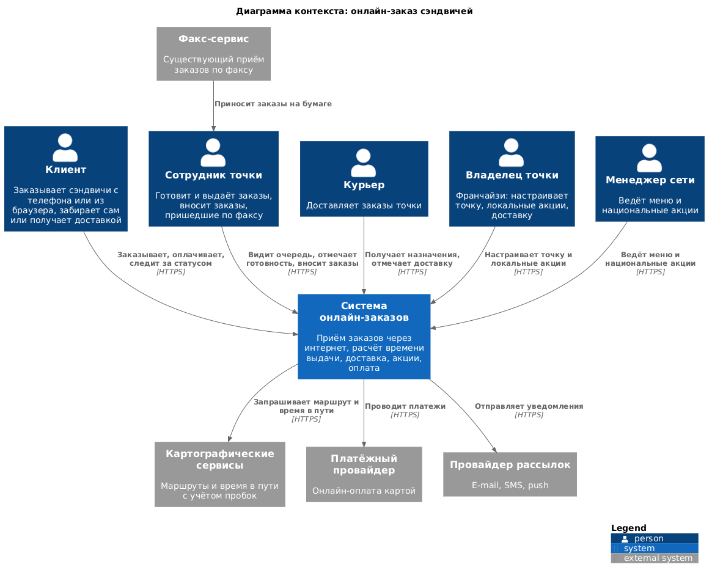
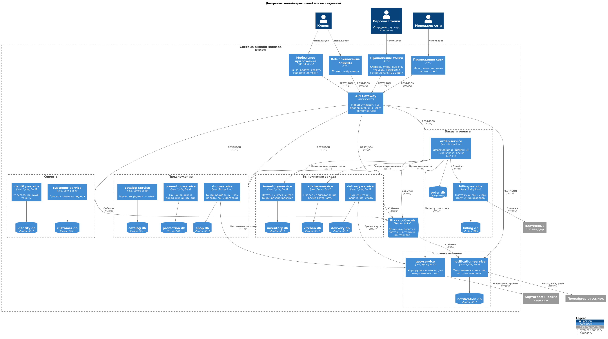

# Декомпозиция интернет-магазина сэндвичей на микросервисы

Архитектурная ката «I'll Have the BLT» (Neal Ford): национальная сеть сэндвич-шопов
принимает заказы по факсу и хочет принимать их через интернет.

## 1. Задача

Требования каты:

- клиент размещает заказ и получает время выдачи и маршрут до точки; маршрут строится
  через внешние картографические сервисы с учётом пробок;
- если точка предлагает доставку, заказ везёт курьер точки;
- доступ с мобильных устройств;
- национальные акции дня и локальные акции дня;
- оплата онлайн или при получении (на точке или курьеру);
- тысячи пользователей, в перспективе миллионы.

Контекст: точки работают по франшизе, у каждой свой владелец; компания планирует выход
за рубеж; корпоративная цель — дешёвая рабочая сила. Приём заказов по факсу остаётся.

## 2. Пользовательские сценарии

Сценарии записаны в формате Given / When / Then.

**С1. Регистрация клиента**
- Есть неавторизованный посетитель в мобильном приложении.
- Когда он вводит имя, телефон, e-mail и пароль и подтверждает регистрацию,
- тогда у него появляется учётная запись и профиль, он входит в приложение и получает
  приветственное уведомление.

**С2. Выбор точки и просмотр меню**
- Есть авторизованный клиент с включённой геолокацией.
- Когда он открывает список точек,
- тогда видит ближайшие точки с расстоянием, временем в пути, часами работы и признаком
  доставки;
- когда выбирает точку,
- тогда видит меню точки с ценами и акциями дня: национальными и локальными этой точки.

**С3. Заказ с самовывозом и онлайн-оплатой**
- Есть клиент, выбравший точку и собравший заказ.
- Когда он выбирает самовывоз, оплату картой и подтверждает заказ,
- тогда система резервирует ингредиенты, проводит платёж, рассчитывает время готовности
  и показывает время выдачи и маршрут до точки с учётом пробок;
- и клиент получает подтверждение заказа с временем выдачи.

**С4. Заказ с доставкой и оплатой при получении**
- Есть клиент на точке, которая предлагает доставку, с адресом внутри зоны доставки.
- Когда он выбирает доставку, оплату курьеру и подтверждает заказ,
- тогда система резервирует ингредиенты, создаёт ожидающий платёж, назначает курьера
  на слот времени и показывает ожидаемое время доставки;
- когда курьер отмечает вручение и оплату,
- тогда заказ завершён, платёж подтверждён.

**С5. Отмена заказа**
- Есть оплаченный заказ, приготовление которого не началось.
- Когда клиент отменяет заказ,
- тогда резерв ингредиентов снимается, курьер освобождается, деньги возвращаются,
  клиент получает уведомление об отмене.

**С6. Приготовление и выдача**
- Есть сотрудник точки с открытой очередью заказов.
- Когда поступает новый заказ,
- тогда он появляется в очереди с временем готовности;
- когда сотрудник отмечает заказ готовым,
- тогда клиент получает уведомление, а заказ с доставкой передаётся курьеру;
- когда сотрудник отмечает выдачу клиенту (и оплату, если она при получении),
- тогда заказ завершён.

**С7. Заказ, пришедший по факсу**
- Есть сотрудник точки и заказ на бумаге.
- Когда сотрудник вносит заказ в приложении точки от имени точки,
- тогда заказ попадает в общую очередь и учитывается в остатках так же, как
  интернет-заказ.

**С8. Локальная акция**
- Есть владелец точки.
- Когда он создаёт акцию дня для своей точки,
- тогда акция видна клиентам только на этой точке и применяется при расчёте заказа.

**С9. Национальная акция**
- Есть менеджер сети.
- Когда он создаёт национальную акцию дня,
- тогда она видна на всех точках региона и применяется при расчёте заказа.

**С10. Доставка**
- Есть курьер точки с назначенным заказом.
- Когда заказ готов,
- тогда курьер видит адрес, маршрут и время в пути;
- когда курьер отмечает вручение,
- тогда заказ завершён, клиент получает уведомление.

## 3. Подход к декомпозиции

Использован паттерн **разбиения по бизнес-возможностям** с уточнением границ через
ограниченные контексты. Порядок работы: из сценариев выписаны системные операции,
по ним построена доменная модель, затем выделены бизнес-возможности, каждая стала
сервисом. После прохода по сценариям границы уточнены.

Бизнес-возможности сети и соответствующие им контексты:

| Бизнес-возможность | Контекст | Сервисы |
|---|---|---|
| Управление клиентами | Клиенты | identity-service, customer-service |
| Управление сетью точек | Предложение | shop-service |
| Управление меню | Предложение | catalog-service |
| Управление акциями | Предложение | promotion-service |
| Приём заказов | Заказ и оплата | order-service |
| Приём платежей | Заказ и оплата | billing-service |
| Выполнение заказа на точке | Выполнение заказа | inventory-service, kitchen-service |
| Доставка | Выполнение заказа | delivery-service |
| Геоданные | Вспомогательные | geo-service |
| Уведомления | Вспомогательные | notification-service |

Решения по границам:

- **Акции отдельно от меню.** Меню ведёт сеть, оно меняется редко. Акции ведут два разных
  владельца (сеть и франчайзи), меняются ежедневно и имеют свои правила применения.
- **Кухня отдельно от заказа.** Заказ — контекст клиента (состав, оплата, статус),
  кухня — контекст точки (очередь, время готовности, выдача). У них разные пользователи
  и разная нагрузка: очередь кухни читается персоналом постоянно.
- **Склад отдельно.** Остатки ингредиентов — данные точки, ими управляет персонал
  независимо от заказов; резерв под заказ — отдельная транзакция.
- **Геосервис как прослойка к внешним картам.** Внешних провайдеров несколько, при
  выходе за рубеж они сменятся; знание о них изолировано в одном сервисе.
- **Идентификация отдельно от профиля.** Учётные данные и токены обслуживает шлюз,
  профиль и адреса — клиентские сценарии; требования к безопасности и темп изменений
  разные.
- **Корзина внутри заказа.** Корзина живёт на клиенте до подтверждения; отдельный
  сервис корзины не нужен.
- **Платежи отдельно от заказа.** Заказ не знает о платёжном провайдере; оплата при
  получении подтверждается позже и другим пользователем.

## 4. Схема взаимодействия сервисов

Диаграммы в нотации C4, исходники — `diagrams/*.puml` (PlantUML, библиотека C4-PlantUML).
Рендер: `docker run --rm -v "$PWD":/work -w /work plantuml/plantuml -charset UTF-8 -tpng diagrams/*.puml`.

### Контекст

### Контейнеры

Принципы взаимодействия:

- клиенты ходят только через API Gateway; шлюз проверяет токен в identity-service и
  передаёт сервисам идентификатор клиента;
- данные, нужные внутри запроса клиента (цены, акции, резерв, платёж, время готовности,
  маршрут), запрашиваются синхронно по HTTP;
- всё, что происходит после факта (постановка в очередь, назначение курьера,
  уведомления, создание счёта), передаётся событиями через Kafka;
- у каждого сервиса своя база данных; geo-service хранит только кэш маршрутов.

## 5. Сервисы

Карточки сервисов по шаблону Microservice Canvas лежат в `services/`.

| Сервис | Назначение | Карточка |
|---|---|---|
| identity-service | Регистрация, вход, выпуск и проверка токенов | [identity-service.md](services/identity-service.md) |
| customer-service | Профиль клиента и адреса доставки | [customer-service.md](services/customer-service.md) |
| shop-service | Точки сети, владельцы, часы работы, зоны доставки | [shop-service.md](services/shop-service.md) |
| catalog-service | Меню, ингредиенты, цены | [catalog-service.md](services/catalog-service.md) |
| promotion-service | Национальные и локальные акции дня | [promotion-service.md](services/promotion-service.md) |
| order-service | Оформление заказа, расчёт стоимости и времени выдачи, статус | [order-service.md](services/order-service.md) |
| billing-service | Счета клиентов, платежи онлайн и при получении, возвраты | [billing-service.md](services/billing-service.md) |
| inventory-service | Остатки ингредиентов точки, резервирование под заказ | [inventory-service.md](services/inventory-service.md) |
| kitchen-service | Очередь приготовления, время готовности, выдача | [kitchen-service.md](services/kitchen-service.md) |
| delivery-service | Курьеры точки, назначение на слот, статус доставки | [delivery-service.md](services/delivery-service.md) |
| geo-service | Маршруты и время в пути поверх внешних карт | [geo-service.md](services/geo-service.md) |
| notification-service | Уведомления клиентам и история отправок | [notification-service.md](services/notification-service.md) |

## 6. Контракты взаимодействия

Внешний API сервисов (для приложений через шлюз) описан в карточках. Ниже — контракты
между сервисами.

### 6.1. Синхронные вызовы (HTTP, JSON)

| Потребитель | Поставщик | Вызов | Назначение |
|---|---|---|---|
| API Gateway | identity-service | `GET /internal/auth/verify` | Проверка токена; в ответ `X-Customer-Id`, роли |
| order-service | shop-service | `GET /api/v1/shops/{shopId}` | Открыта ли точка, есть ли доставка, зона доставки |
| order-service | catalog-service | `POST /api/v1/menu/prices` `{shopId, itemIds}` | Актуальные цены позиций |
| order-service | promotion-service | `POST /api/v1/promotions/apply` `{shopId, items}` | Скидки по акциям дня |
| order-service | inventory-service | `POST /api/v1/reservations` `{orderId, shopId, items}` | Резерв ингредиентов |
| order-service | inventory-service | `DELETE /api/v1/reservations/{orderId}` | Снятие резерва при отказе платежа |
| order-service | billing-service | `POST /api/v1/payments` `{orderId, customerId, amount, method}` | Платёж: онлайн — проведён сразу, при получении — ожидает |
| order-service | kitchen-service | `POST /api/v1/shops/{shopId}/estimate` `{items}` | Ожидаемое время готовности |
| order-service | geo-service | `POST /api/v1/routes` `{from, to, mode}` | Маршрут и время в пути до точки |
| delivery-service | geo-service | `POST /api/v1/routes` | Время в пути курьера до адреса |
| shop-service | geo-service | `POST /api/v1/routes` | Расстояние и время в пути до ближайших точек |

Ошибка любого синхронного вызова при оформлении заказа приводит к отказу в заказе и
снятию уже сделанного резерва.

### 6.2. События (Kafka)

Ключ сообщения — идентификатор заказа или клиента, формат — JSON.

| Событие | Публикует | Подписаны | Содержимое |
|---|---|---|---|
| `CustomerRegistered` | identity-service | customer-service, billing-service, notification-service | customerId, name, email, phone |
| `OrderPlaced` | order-service | kitchen-service, delivery-service, notification-service | orderId, customerId, shopId, items, fulfillment, deliveryAddress, amount, paymentMethod, readyAt |
| `OrderCancelled` | order-service | kitchen-service, inventory-service, billing-service, delivery-service, notification-service | orderId, shopId, reason |
| `PaymentConfirmed` | billing-service | order-service, notification-service | orderId, paymentId, amount |
| `PaymentFailed` | billing-service | order-service, notification-service | orderId, paymentId, reason |
| `OrderReady` | kitchen-service | order-service, inventory-service, delivery-service, notification-service | orderId, shopId, readyAt |
| `OrderHandedOver` | kitchen-service | order-service | orderId, shopId |
| `DeliveryAssigned` | delivery-service | order-service, notification-service | orderId, courierId, expectedAt |
| `DeliveryCompleted` | delivery-service | order-service, billing-service, notification-service | orderId, courierId, paidOnDelivery |

### 6.3. Оформление заказа по шагам

1. Клиент отправляет `POST /api/v1/orders` в order-service.
2. order-service проверяет точку в shop-service, получает цены из catalog-service и
   скидки из promotion-service, считает сумму.
3. order-service резервирует ингредиенты в inventory-service.
4. order-service создаёт платёж в billing-service: онлайн — платёж проходит сразу,
   при получении — остаётся ожидающим.
5. order-service получает время готовности от kitchen-service и, для самовывоза, маршрут
   от geo-service; сохраняет заказ и публикует `OrderPlaced`.
6. kitchen-service ставит заказ в очередь; delivery-service для доставки назначает
   курьера и публикует `DeliveryAssigned`; notification-service отправляет подтверждение.
7. Готовность (`OrderReady`) переводит заказ в состояние «готов», списывает резерв и
   отправляет курьера или уведомляет клиента о выдаче.
8. Выдача (`OrderHandedOver`) или вручение (`DeliveryCompleted`) завершает заказ;
   при оплате при получении billing-service подтверждает платёж.

## 7. Учёт будущих изменений

- **Выход за рубеж.** Регион — атрибут точки, меню и акции; валюта и платёжные
  провайдеры скрыты в billing-service, картографические провайдеры — в geo-service,
  язык уведомлений — в notification-service. Новая страна — новые данные и адаптеры,
  а не новые сервисы.
- **Франшиза.** Владелец точки управляет только своей точкой: настройками, курьерами,
  локальными акциями, остатками. Права проверяются по принадлежности точки.
- **Дешёвая рабочая сила.** Приложение точки сводится к очереди с двумя действиями
  («готов», «выдан»); время готовности считается автоматически.
- **Рост до миллионов пользователей.** Сервисы без состояния и масштабируются
  независимо; самые читаемые данные (меню, акции, точки) отдаются из кэша; тяжёлые
  потоки (уведомления, очередь кухни) разгружены через Kafka.
- **Новые каналы приёма заказа.** Факс, терминал на точке, партнёрские агрегаторы
  приходят в тот же `POST /api/v1/orders` от имени точки или партнёра.
