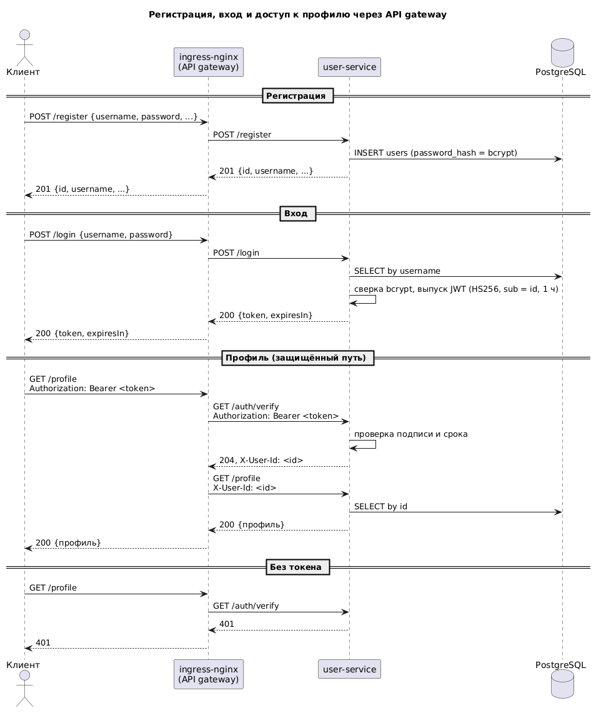

# user-service: регистрация, вход и профиль через API gateway

Сервис пользователей из прошлых заданий научился регистрировать пользователей, пускать их по
паролю и отдавать каждому только его собственный профиль. Роль API gateway играет ingress-nginx:
на защищённые пути он не пропускает запрос, пока user-service не подтвердит токен, и сам
подставляет в запрос идентификатор пользователя.

## Архитектура



- **Регистрация и вход** живут в user-service. Пароль хранится как bcrypt-хеш, при входе
  выдаётся JWT (HS256, срок час), подписанный секретом из Kubernetes Secret.
- **Проверка на шлюзе.** Для путей `/profile` у Ingress стоят аннотации `auth-url` и
  `auth-response-headers`. На каждый такой запрос ingress-nginx сначала вызывает
  `GET /auth/verify` user-service с заголовком `Authorization` клиента. Если токен верный,
  сервис отвечает 204 и заголовком `X-User-Id`; nginx подставляет его в исходный запрос и
  проксирует дальше. Если нет, клиент получает 401, до сервиса запрос не доходит.
- **Профиль только свой.** Обработчики `/profile` не принимают идентификатор от клиента:
  он берётся из `X-User-Id`, который выставил шлюз. Заголовок, присланный клиентом
  напрямую, nginx заменяет на свой, а без токена запрос до сервиса не доходит, поэтому
  прочитать или изменить чужой профиль нельзя ни анонимно, ни под другим пользователем.
- Внутри сервиса Spring Security без сессий: `/profile/**` требует аутентификации, которую
  фильтр создаёт из `X-User-Id`; остальные пути открыты.

Два объекта Ingress нужны потому, что аннотации проверки действуют на весь Ingress целиком:
один без проверки для `/register`, `/login`, `/health`, второй с проверкой для `/profile`.

## API

| Метод | Путь | Ответ |
|---|---|---|
| `POST /register` | `{username, password, firstName, lastName, email, phone}` | 201 и пользователь без пароля |
| `POST /login` | `{username, password}` | 200 `{token, expiresIn}`, 401 при неверной паре |
| `GET /auth/verify` | заголовок `Authorization: Bearer …` | 204 + `X-User-Id`, иначе 401; вызывает шлюз |
| `GET /profile` | `Authorization: Bearer …` | 200 профиль текущего пользователя |
| `PUT /profile` | `{firstName, lastName, email, phone}` | 200 обновлённый профиль |
| `GET /health` | | 200 `{"status":"OK"}` |

Ошибки в формате `{"code", "message"}`: 400 невалидное тело, 401 нет или неверный токен,
409 занятый `username`.

## Состав

- `src/` — приложение: `controller` (`AuthController`, `ProfileController`), `service`
  (`AuthService`, `ProfileService`), `security` (конфигурация Spring Security, фильтр
  `X-User-Id`, настройки JWT), `dto`, `entity`, `repository`; миграции Flyway `V1` (таблица
  пользователей) и `V2` (хеш пароля).
- `Dockerfile` — образ `boldyrevma/user-service:hw6`.
- `k8s/` — namespace, ConfigMap, Secret базы, Secret ключа JWT, Job миграций, Deployment,
  Service, два Ingress.
- `helm/user-service/` — те же объекты чартом.
- `db/` — values для CloudNativePG: оператор и кластер PostgreSQL.
- `postman/user-service.postman_collection.json` — сценарий из двенадцати шагов со
  случайными данными; `postman/newman-output.txt` — вывод `newman run --verbose` с телами
  запросов и ответов.
- `docs/auth-flow.puml`, `docs/auth-flow.png` — схема взаимодействия.
- `kind/`, `ingress-nginx/` — конфигурация кластера и ingress-контроллера.

## Сборка образа

```bash
./gradlew build
docker build --platform linux/amd64 -t boldyrevma/user-service:hw6 .
docker push boldyrevma/user-service:hw6
```

## Кластер и ingress-nginx

```bash
minikube start --driver=docker --ports=127.0.0.1:80:80,127.0.0.1:443:443
# или: kind create cluster --config kind/cluster.yaml
# в /etc/hosts: 127.0.0.1 arch.homework

kubectl create namespace m
helm repo add ingress-nginx https://kubernetes.github.io/ingress-nginx/
helm repo update
helm install nginx ingress-nginx/ingress-nginx --namespace m -f ingress-nginx/values.yaml
kubectl -n m rollout status daemonset/nginx-ingress-nginx-controller
```

API gateway это тот же ingress-nginx, отдельной установки шлюза нет.

## Установка приложения

Всё приложение ставится в namespace `msa`. Secret с учётной записью базы и ключом JWT
создаются до базы и приложения:

```bash
kubectl apply -f k8s/00-namespace.yaml -f k8s/11-secret.yaml -f k8s/12-jwt-secret.yaml

helm repo add cnpg https://cloudnative-pg.github.io/charts
helm repo update
helm install cnpg cnpg/cloudnative-pg --namespace cnpg-system --create-namespace -f db/operator-values.yaml
kubectl -n cnpg-system rollout status deployment/cnpg-cloudnative-pg
helm install user-db cnpg/cluster --namespace msa -f db/values.yaml
kubectl -n msa wait cluster/user-db --for=condition=Ready --timeout=300s

kubectl apply -f k8s/
kubectl -n msa wait job/user-service-migrate --for=condition=complete --timeout=180s
kubectl -n msa rollout status deployment/user-service
```

Вариант чартом вместо `kubectl apply -f k8s/` (Secret JWT и базы чарт создаёт сам, порядок
как в hw4: чарт, затем база):

```bash
helm install user-service helm/user-service --namespace msa --create-namespace
helm install user-db cnpg/cluster --namespace msa -f db/values.yaml
```

## Проверка

```bash
curl -s -X POST http://arch.homework/register -H 'Content-Type: application/json' \
  -d '{"username":"alice","password":"secret123","firstName":"Alice","lastName":"Doe","email":"alice@example.com","phone":"+71000000001"}'
TOKEN=$(curl -s -X POST http://arch.homework/login -H 'Content-Type: application/json' \
  -d '{"username":"alice","password":"secret123"}' | jq -r .token)
curl -i http://arch.homework/profile                              # 401
curl -s http://arch.homework/profile -H "Authorization: Bearer $TOKEN"   # профиль alice

newman run postman/user-service.postman_collection.json --verbose
```

Сценарий коллекции: регистрация пользователя 1 со случайными данными, профиль без входа
недоступен на чтение и запись, вход, изменение и проверка профиля, регистрация и вход
пользователя 2, пользователь 2 видит и меняет только свой профиль, профиль пользователя 1
не изменился, подделанный `X-User-Id` без токена отклоняется. `--verbose` печатает заголовки
и тела запросов и ответов.

## Удаление

```bash
helm uninstall user-db --namespace msa
kubectl delete -f k8s/        # при установке чартом: helm uninstall user-service --namespace msa && kubectl delete namespace msa
helm uninstall cnpg --namespace cnpg-system
kubectl delete namespace cnpg-system
helm uninstall nginx --namespace m && kubectl delete namespace m
```

Кластер целиком: `minikube delete` или `kind delete cluster --name msa`. Образ: `docker rmi
boldyrevma/user-service:hw6`, тег в Docker Hub удаляется на странице репозитория.
