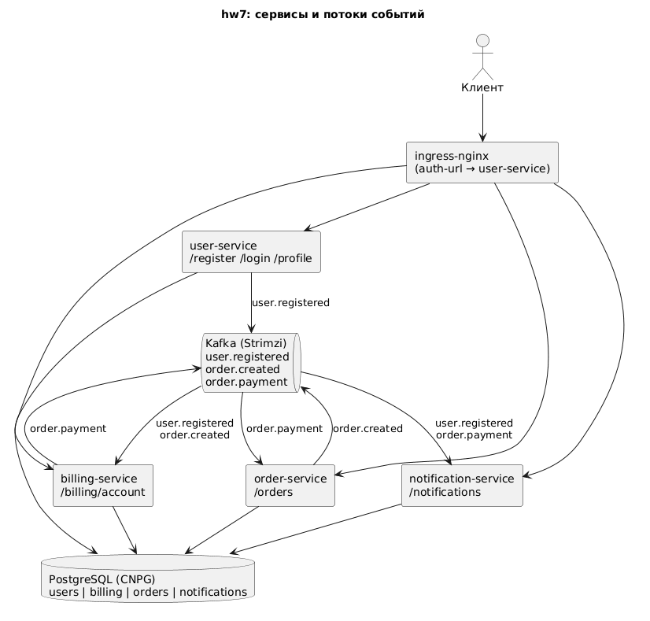

# Заказ, биллинг и уведомления через события

Четыре сервиса на Spring Boot общаются через Kafka в стиле Event Collaboration: регистрация
пользователя создаёт счёт в биллинге, заказ публикует событие, биллинг списывает деньги и
публикует итог, по итогу заказ меняет статус, а сервис уведомлений пишет письмо счастья или
письмо горя. Письма не отправляются, а сохраняются в базе и читаются через API.
Варианты взаимодействия с диаграммами и IDL разобраны в
[docs/interaction-options.md](docs/interaction-options.md).

## Архитектура



| Сервис | Хранит | Публикует | Слушает | API |
|---|---|---|---|---|
| user-service | пользователи, пароли | `user.registered` | — | `/register`, `/login`, `/auth/verify`, `/profile` |
| billing-service | счета | `order.payment` | `user.registered` → создать счёт; `order.created` → списать | `/billing/account`, `/billing/account/deposit`, `/billing/account/withdraw` |
| order-service | заказы | `order.created` | `order.payment` → PAID или REJECTED | `/orders`, `/orders/{id}` |
| notification-service | получатели, письма | — | `user.registered` → запомнить email; `order.payment` → письмо | `/notifications` |

Темы Kafka: `user.registered {userId, username, email}`, `order.created {orderId, userId,
price}`, `order.payment {orderId, userId, price, status: COMPLETED | FAILED, reason}`. Ключ
сообщения — идентификатор пользователя или заказа.

Аутентификация как в hw6: `POST /login` выдаёт JWT, ingress-nginx на пути `/profile`,
`/billing`, `/orders`, `/notifications` вызывает `/auth/verify` и подставляет `X-User-Id`,
сервисы работают только с данными этого пользователя. По условию задания сбои сервисов не
рассматриваются: события публикуются сразу после записи в базу, без outbox и повторов.

## API

Все пути, кроме `/register`, `/login` и `/health`, требуют `Authorization: Bearer <token>`.

| Метод | Путь | Ответ |
|---|---|---|
| `POST /register` | `{username, password, firstName, lastName, email, phone}` | 201 пользователь; событие `user.registered` |
| `POST /login` | `{username, password}` | 200 `{token, expiresIn}` |
| `GET /billing/account` | | 200 `{userId, balance}` |
| `POST /billing/account/deposit` | `{amount}` | 200 счёт |
| `POST /billing/account/withdraw` | `{amount}` | 200 счёт, 409 `insufficient funds` |
| `POST /orders` | `{price}` | 201 заказ в статусе `NEW`; событие `order.created` |
| `GET /orders`, `GET /orders/{id}` | | 200 заказы пользователя: `status` `NEW`, `PAID`, `REJECTED`, `reason` |
| `GET /notifications` | | 200 письма пользователя, новые первыми |

## Состав

- `services/<имя>/` — четыре самостоятельных Gradle-проекта с одинаковой раскладкой:
  `controller`, `service`, `repository`, `entity`, `dto`, `event` (записи событий, слушатели
  `@KafkaListener`, издатели через `KafkaTemplate`), миграции Flyway, тесты, Dockerfile.
  Образы `boldyrevma/<имя>:hw7`.
- `k8s/` — манифесты в порядке применения: namespace, Secret базы и ключа JWT, базы
  (`Database` CloudNativePG), темы Kafka, по файлу на сервис (ConfigMap, Job миграций,
  Deployment, Service), два Ingress: открытый и с проверкой токена.
- `kafka/kafka.yaml` — Kafka из одного узла в режиме KRaft для оператора Strimzi.
- `db/` — values CloudNativePG: оператор и один кластер PostgreSQL `msa-db`, в нём базы
  `users`, `billing`, `orders`, `notifications`.
- `postman/order-flow.postman_collection.json` — сценарий задания, `postman/newman-output.txt`
  — вывод `newman run --verbose`.
- `docs/` — схема архитектуры и три варианта взаимодействия с IDL.
- `kind/`, `ingress-nginx/` — конфигурация кластера и ingress-контроллера.

## Сборка образов

В каждом каталоге `services/<имя>`:

```bash
./gradlew build
docker build --platform linux/amd64 -t boldyrevma/<имя>:hw7 .
docker push boldyrevma/<имя>:hw7
```

## Кластер и ingress-nginx

```bash
minikube start --driver=docker --ports=127.0.0.1:80:80,127.0.0.1:443:443 --memory 6g
# или: kind create cluster --config kind/cluster.yaml
# в /etc/hosts: 127.0.0.1 arch.homework

kubectl create namespace m
helm repo add ingress-nginx https://kubernetes.github.io/ingress-nginx/
helm repo update
helm install nginx ingress-nginx/ingress-nginx --namespace m -f ingress-nginx/values.yaml
kubectl -n m rollout status daemonset/nginx-ingress-nginx-controller
```

## Установка

Приложение ставится в namespace `msa`; операторы — в свои: CloudNativePG в `cnpg-system`,
Strimzi в `kafka` (он следит за ресурсами Kafka в `msa`).

```bash
helm repo add cnpg https://cloudnative-pg.github.io/charts
helm repo add strimzi https://strimzi.io/charts/
helm repo update

helm install cnpg cnpg/cloudnative-pg --namespace cnpg-system --create-namespace -f db/operator-values.yaml
kubectl -n cnpg-system rollout status deployment/cnpg-cloudnative-pg
helm install strimzi strimzi/strimzi-kafka-operator --namespace kafka --create-namespace \
  --set watchNamespaces="{msa}" \
  --set resources.requests.cpu=100m --set resources.requests.memory=256Mi \
  --set resources.limits.cpu=500m --set resources.limits.memory=384Mi
kubectl -n kafka rollout status deployment/strimzi-cluster-operator
```

База и Kafka. Secret должен существовать до кластера PostgreSQL:

```bash
kubectl apply -f k8s/00-namespace.yaml -f k8s/01-secrets.yaml
helm install msa-db cnpg/cluster --namespace msa -f db/values.yaml
kubectl apply -f kafka/kafka.yaml
kubectl -n msa wait cluster/msa-db --for=condition=Ready --timeout=300s
kubectl -n msa wait kafka/msa-kafka --for=condition=Ready --timeout=600s
```

Сервисы. Одна команда применяет всё по порядку номеров: базы, темы, миграции, приложения,
Ingress; Job и поды дожидаются базы через initContainer:

```bash
kubectl apply -f k8s/
kubectl -n msa wait job --all --for=condition=complete --timeout=300s
kubectl -n msa rollout status deployment --timeout=300s
```

## Проверка

```bash
newman run postman/order-flow.postman_collection.json --verbose
```

Сценарий: регистрация со случайными данными и вход; счёт создан событием, баланс 0;
пополнение на 100; заказ на 60 — через две секунды баланс 40, заказ `PAID`, в уведомлениях
письмо «оплачен»; заказ на 100 — баланс остался 40, заказ `REJECTED` с причиной, второе
письмо «отклонён». Паузы в две секунды в коллекции дают событиям дойти через Kafka.

Посмотреть события напрямую:

```bash
kubectl -n msa run kafka-cli --rm -it --restart=Never --image=quay.io/strimzi/kafka:latest-kafka-4.3.1 -- \
  bin/kafka-console-consumer.sh --bootstrap-server msa-kafka-kafka-bootstrap:9092 --topic order.payment --from-beginning
```

## Удаление

```bash
kubectl delete -f k8s/                       # приложения, темы, базы, namespace msa с томом PostgreSQL
helm uninstall msa-db --namespace msa 2>/dev/null || true
helm uninstall strimzi --namespace kafka && kubectl delete namespace kafka
helm uninstall cnpg --namespace cnpg-system && kubectl delete namespace cnpg-system
helm uninstall nginx --namespace m && kubectl delete namespace m
```

Удаление namespace `msa` уносит и кластер PostgreSQL, и Kafka, поэтому `helm uninstall
msa-db` после него уже не находит релиз — это ожидаемо. Образы: `docker rmi
boldyrevma/<имя>:hw7`, теги в Docker Hub удаляются на странице репозитория.
