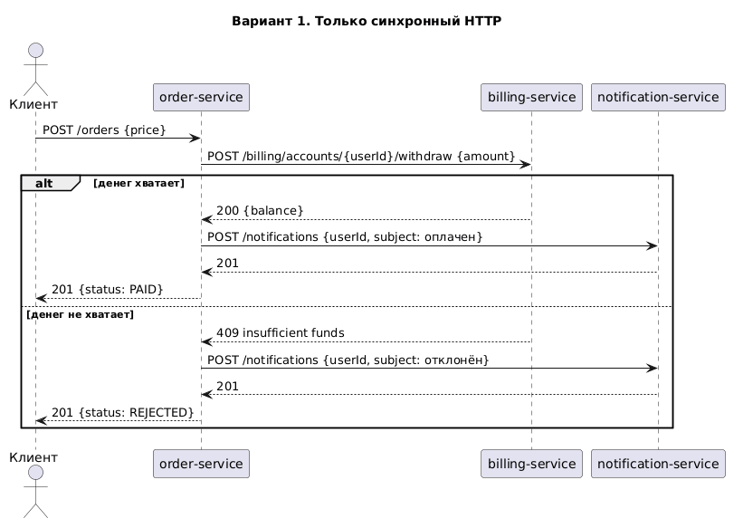
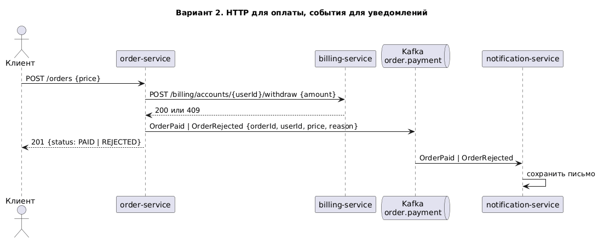
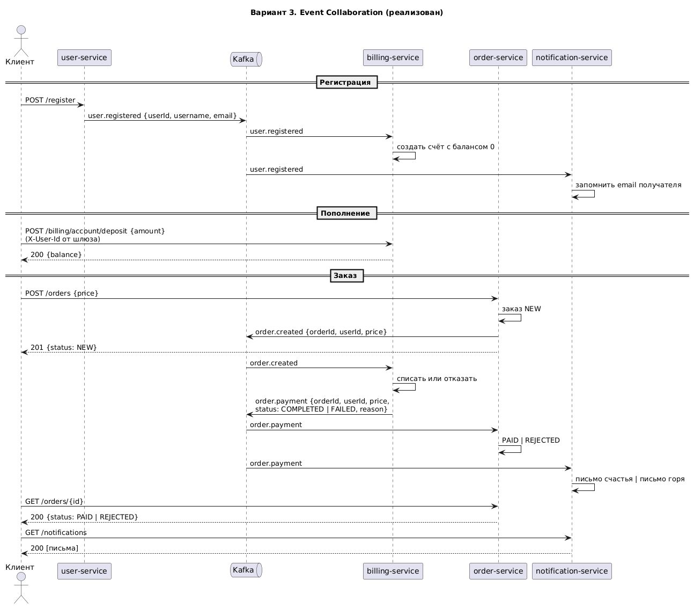

# Варианты взаимодействия сервисов при создании заказа

Участники: order-service (заказ), billing-service (счёт пользователя), notification-service
(письма, которые сохраняются в базу). Пользователь уже аутентифицирован шлюзом, во все
запросы подставлен `X-User-Id`.

## Вариант 1. Только HTTP



Заказ синхронно вызывает биллинг, затем синхронно сервис уведомлений, и только потом
отвечает клиенту. Просто и прозрачно, итог известен сразу в ответе на `POST /orders`.
Минусы: заказ знает про оба сервиса и их адреса, время ответа складывается из трёх вызовов,
недоступность уведомлений ломает оформление заказа, хотя письмо не часть сделки.

IDL (OpenAPI, фрагменты):

```yaml
paths:
  /orders:
    post:
      requestBody: { content: { application/json: { schema: { $ref: '#/components/schemas/CreateOrder' } } } }
      responses: { '201': { description: заказ создан, status PAID или REJECTED, schema Order } }
  /billing/accounts/{userId}/withdraw:
    post:
      requestBody: { content: { application/json: { schema: { $ref: '#/components/schemas/Amount' } } } }
      responses: { '200': { description: списано, schema Account }, '409': { description: insufficient funds, schema Error } }
  /notifications:
    post:
      requestBody: { content: { application/json: { schema: { $ref: '#/components/schemas/NewMessage' } } } }
      responses: { '201': { description: письмо сохранено } }
components:
  schemas:
    CreateOrder: { type: object, required: [price], properties: { price: { type: number } } }
    Amount:      { type: object, required: [amount], properties: { amount: { type: number } } }
    NewMessage:  { type: object, required: [userId, subject, body], properties: { userId: { type: integer }, subject: { type: string }, body: { type: string } } }
    Order:       { type: object, properties: { id: { type: integer }, userId: { type: integer }, price: { type: number }, status: { type: string, enum: [PAID, REJECTED] } } }
    Account:     { type: object, properties: { userId: { type: integer }, balance: { type: number } } }
    Error:       { type: object, properties: { code: { type: integer }, message: { type: string } } }
```

## Вариант 2. HTTP для оплаты, события для уведомлений



Списание остаётся синхронным, а письмо уходит через брокер: заказ публикует событие с
итогом, сервис уведомлений его читает. Уведомления перестают влиять на время ответа и
доступность заказа. Заказ по-прежнему связан с биллингом напрямую.

IDL: HTTP-часть как в варианте 1 без `POST /notifications`; события (AsyncAPI, фрагмент):

```yaml
channels:
  order.payment:
    publish:
      message:
        name: OrderPaymentResult
        payload:
          type: object
          required: [orderId, userId, price, status]
          properties:
            orderId: { type: integer }
            userId:  { type: integer }
            price:   { type: number }
            status:  { type: string, enum: [COMPLETED, FAILED] }
            reason:  { type: string }
```

## Вариант 3. Event Collaboration



Сервисы не вызывают друг друга вовсе, а реагируют на события. Регистрация публикует
`user.registered`, по нему биллинг заводит счёт, а уведомления запоминают email. Заказ
публикует `order.created` и сразу отвечает клиенту статусом `NEW`; биллинг списывает деньги
и публикует `order.payment`; заказ по нему меняет статус, уведомления пишут письмо. Клиент
узнаёт итог следующим запросом. Связность минимальная, каждый сервис знает только темы;
цена: итог заказа асинхронный, и нужно следить за порядком и повторной доставкой событий.

IDL событий (AsyncAPI, фрагмент):

```yaml
channels:
  user.registered:
    publish: { message: { payload: { type: object, properties: { userId: { type: integer }, username: { type: string }, email: { type: string } } } } }
  order.created:
    publish: { message: { payload: { type: object, properties: { orderId: { type: integer }, userId: { type: integer }, price: { type: number } } } } }
  order.payment:
    publish: { message: { payload: { type: object, properties: { orderId: { type: integer }, userId: { type: integer }, price: { type: number }, status: { type: string, enum: [COMPLETED, FAILED] }, reason: { type: string } } } } }
```

HTTP остаётся только между клиентом и сервисами (см. таблицу API в README).

## Выбор

Реализован вариант 3. Для учебной задачи с условием «сервисы не падают» хватило бы и
варианта 1, но Event Collaboration ложится на следующие задания: в hw8 к цепочке
добавляются склад и доставка с откатом через компенсирующие события, а в hw9 ключ
идемпотентности защищает именно асинхронное создание заказа. Ключ сообщений во всех темах —
идентификатор заказа или пользователя, поэтому события одного заказа читаются по порядку.
