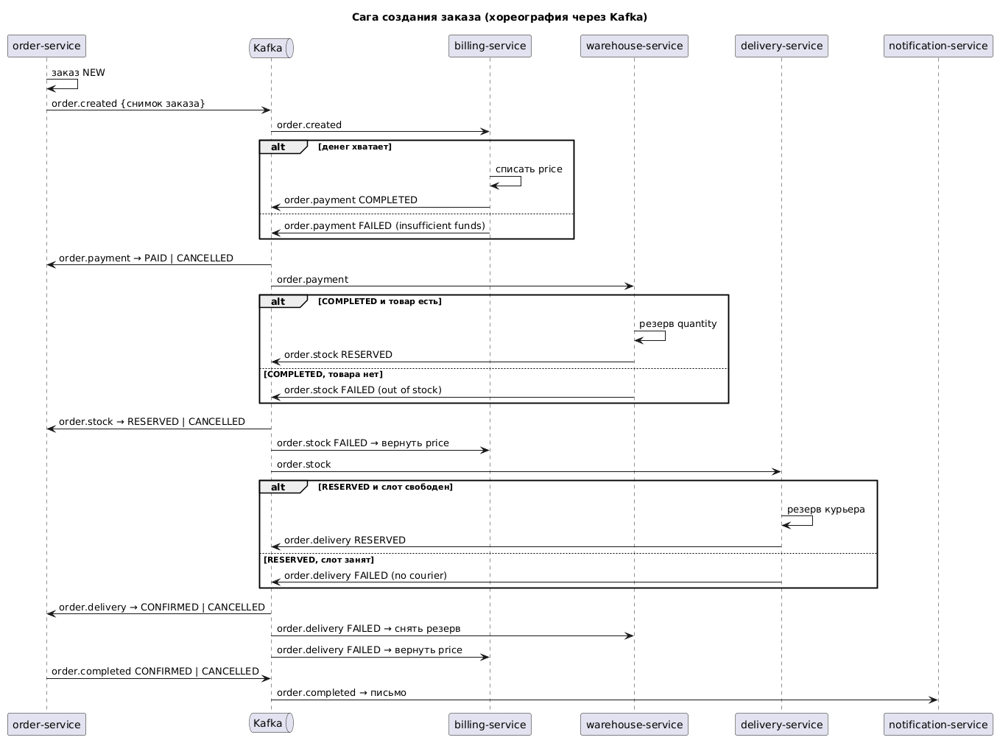
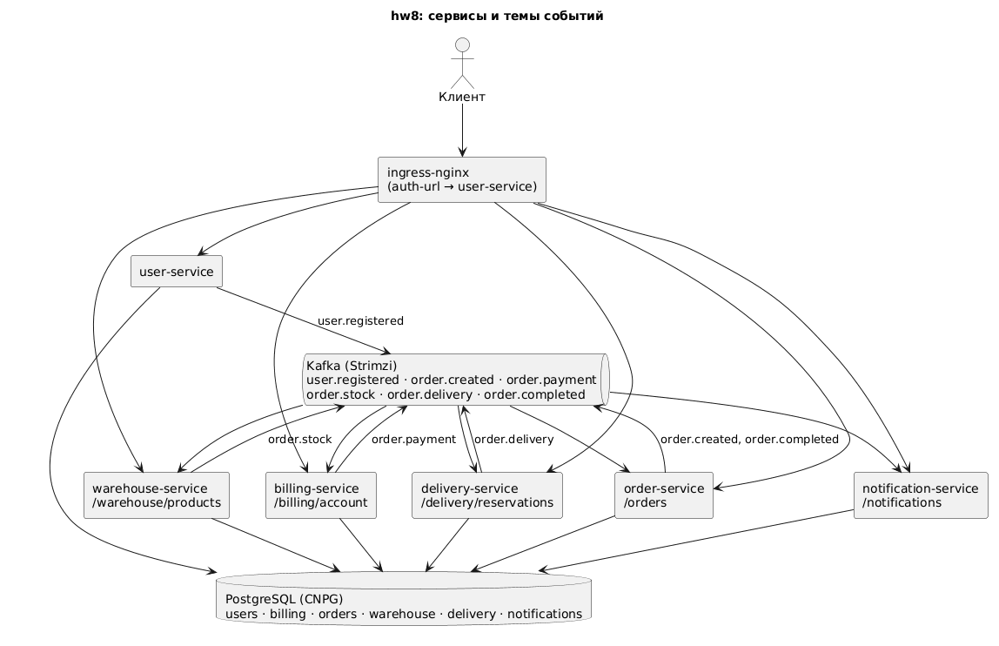

# Создание заказа как распределённая транзакция: сага

Создание заказа проходит через три сервиса: биллинг списывает деньги, склад резервирует
товар, доставка резервирует курьера на слот. Если любой шаг не удался, предыдущие
откатываются: деньги возвращаются на счёт, резерв на складе снимается. Реализовано как
**сага в стиле хореографии**: координатора нет, каждый сервис реагирует на событие
предыдущего шага и публикует своё, компенсации тоже запускаются событиями об отказе.

## Паттерн



Снимок заказа (`orderId, userId, price, productId, quantity, slot`) идёт через цепочку тем
Kafka, каждый шаг добавляет в него свой `status` и `reason`:

| Шаг | Слушает | Делает | Публикует |
|---|---|---|---|
| order-service | `POST /orders` | сохраняет заказ `NEW` | `order.created` |
| billing-service | `order.created` | списывает `price` со счёта | `order.payment` `COMPLETED` или `FAILED` |
| warehouse-service | `order.payment` (только `COMPLETED`) | резервирует `quantity` товара | `order.stock` `RESERVED` или `FAILED` |
| delivery-service | `order.stock` (только `RESERVED`) | резервирует курьера на `slot` | `order.delivery` `RESERVED` или `FAILED` |
| order-service | `order.payment`, `order.stock`, `order.delivery` | `PAID` → `RESERVED` → `CONFIRMED`; любой `FAILED` → `CANCELLED` с причиной | `order.completed` |
| notification-service | `order.completed` | письмо «подтверждён» или «отменён» | — |

Компенсации:

| Отказ | Кто откатывает | Как |
|---|---|---|
| `order.payment FAILED` | никто | откатывать нечего, денег не списали |
| `order.stock FAILED` | billing-service | слушает `order.stock`, возвращает `price` на счёт |
| `order.delivery FAILED` | warehouse-service и billing-service | склад снимает резерв по `orderId`, биллинг возвращает `price` |

Почему хореография, а не оркестратор или двухфазный коммит: шагов три и порядок линейный,
каждый сервис знает только свои темы, а Kafka и события уже есть с hw7; откаты это обычные
обработчики событий об отказе. Двухфазный коммит потребовал бы блокировок в трёх базах и
координатора, что для такого потока избыточно. Ключ сообщений во всех темах — `orderId`,
поэтому события одного заказа обрабатываются по порядку. По условию задания сбои сервисов и
повторная доставка не рассматриваются.

## Архитектура



Шесть сервисов в namespace `msa`, у каждого своя база в одном кластере PostgreSQL,
общая Kafka, вход через ingress-nginx с проверкой JWT в user-service (`auth-url`,
заголовок `X-User-Id`). На складе два товара: `1` с остатком 100 и `2` с остатком 0; курьер
один, поэтому слот можно занять один раз.

## API

Все пути, кроме `/register`, `/login` и `/health`, требуют `Authorization: Bearer <token>`.

| Метод | Путь | Ответ |
|---|---|---|
| `POST /register`, `POST /login` | как в hw6 | 201 / 200 `{token}` |
| `GET /billing/account`, `POST /billing/account/deposit {amount}` | | 200 `{userId, balance}` |
| `POST /orders` | `{price, productId, quantity, slot}` | 201 заказ `NEW`; запуск саги |
| `GET /orders`, `GET /orders/{id}` | | `status`: `NEW`, `PAID`, `RESERVED`, `CONFIRMED`, `CANCELLED` + `reason` |
| `GET /warehouse/products`, `GET /warehouse/products/{id}` | | `{id, name, available}` |
| `GET /delivery/reservations` | | резервы курьера пользователя `{orderId, slot}` |
| `GET /notifications` | | письма пользователя |

## Состав

- `services/<имя>/` — шесть Gradle-проектов: user, billing, order, warehouse, delivery,
  notification; раскладка как в hw7, события в пакете `event`, снимок заказа — запись
  `OrderEvent`. Образы `boldyrevma/<имя>:hw8`.
- `k8s/` — namespace, Secret, пять `Database`, шесть `KafkaTopic`, по файлу на сервис,
  два Ingress. `kafka/kafka.yaml` — Kafka для Strimzi, `db/` — values CloudNativePG.
- `postman/order-saga.postman_collection.json` — сценарий: успешная сага и три отказа с
  проверкой откатов; `postman/newman-output.txt` — вывод прогона.
- `docs/` — схемы саги и архитектуры.

## Установка

Namespace приложения `msa`, операторы в `cnpg-system` и `kafka`; кластер и ingress-nginx
как в hw7.

```bash
helm repo add cnpg https://cloudnative-pg.github.io/charts
helm repo add strimzi https://strimzi.io/charts/
helm repo update
helm install cnpg cnpg/cloudnative-pg --namespace cnpg-system --create-namespace -f db/operator-values.yaml
kubectl -n cnpg-system rollout status deployment/cnpg-cloudnative-pg
helm install strimzi strimzi/strimzi-kafka-operator --namespace kafka --create-namespace \
  --set watchNamespaces="{msa}" \
  --set resources.requests.cpu=100m --set resources.requests.memory=256Mi \
  --set resources.limits.cpu=500m --set resources.limits.memory=384Mi
kubectl -n kafka rollout status deployment/strimzi-cluster-operator

kubectl apply -f k8s/00-namespace.yaml -f k8s/01-secrets.yaml
helm install msa-db cnpg/cluster --namespace msa -f db/values.yaml
kubectl apply -f kafka/kafka.yaml
kubectl -n msa wait cluster/msa-db --for=condition=Ready --timeout=300s
kubectl -n msa wait kafka/msa-kafka --for=condition=Ready --timeout=600s

kubectl apply -f k8s/
kubectl -n msa wait job --all --for=condition=complete --timeout=300s
kubectl -n msa rollout status deployment --timeout=300s
```

Образы собираются и публикуются из каждого `services/<имя>` командами
`./gradlew build`, `docker build --platform linux/amd64 -t boldyrevma/<имя>:hw8 .`,
`docker push boldyrevma/<имя>:hw8`.

## Проверка

```bash
newman run postman/order-saga.postman_collection.json --verbose
```

Пять блоков: регистрация, вход, пополнение на 100 и остаток товара до заказов; успешный
заказ на 60 (товар 1 × 2) → `CONFIRMED`, баланс 40, остаток меньше на 2, резерв курьера на
слот; заказ на 100 → `CANCELLED insufficient funds`, баланс 40; заказ товара 2 → `CANCELLED
out of stock`, деньги вернулись, баланс 40; заказ на тот же слот → `CANCELLED no courier`,
резерв товара снят, деньги вернулись; в уведомлениях одно письмо о подтверждении и три об
отмене. Паузы по три секунды перед чтением дают событиям пройти всю цепочку.

## Удаление

```bash
kubectl delete -f k8s/
helm uninstall strimzi --namespace kafka && kubectl delete namespace kafka
helm uninstall cnpg --namespace cnpg-system && kubectl delete namespace cnpg-system
helm uninstall nginx --namespace m && kubectl delete namespace m
```

Удаление namespace `msa` уносит кластер PostgreSQL и Kafka вместе с томами.
