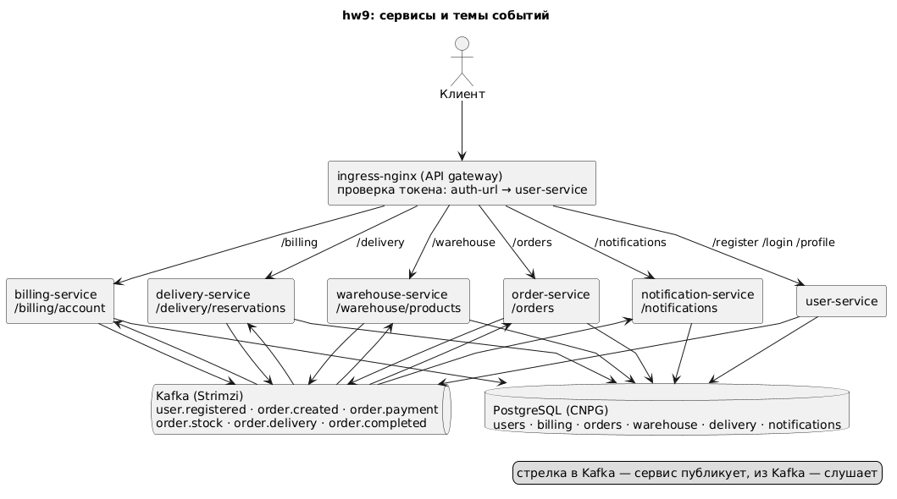

# Идемпотентное создание заказа

Те же шесть сервисов, что в саге заказа, с одним изменением в order-service: метод
`POST /orders` стал идемпотентным.
Повтор запроса с тем же ключом не создаёт второй заказ, не списывает деньги второй раз и не
запускает сагу повторно, а возвращает уже созданный заказ.

## Паттерн: ключ идемпотентности

Клиент присылает в заголовке `Idempotency-Key` уникальное значение на каждое намерение
создать заказ (обычно UUID) и повторяет запрос с тем же ключом, если не дождался ответа.
Сервис хранит таблицу `idempotency_keys (user_id, key, request_hash, order_id)`:

| Ситуация | Что делает сервис | Ответ |
|---|---|---|
| ключа нет в таблице | создаёт заказ, запоминает ключ, отпечаток тела и id заказа в одной транзакции, публикует `order.created` | 201 заказ |
| ключ есть, отпечаток тела совпадает | ничего не создаёт, возвращает сохранённый заказ в его текущем статусе | 201 тот же заказ |
| ключ есть, тело другое | отказывает: клиент пытается переиспользовать ключ для другого заказа | 422 |
| заголовка нет | отказывает | 400 |

Ключ привязан к пользователю (`X-User-Id` от шлюза), поэтому ключи разных пользователей не
пересекаются. Отпечаток тела — SHA-256 от полей запроса. Запись ключа и заказа идёт в одной
транзакции базы заказов, так что два одновременных запроса с одним ключом упрутся в первичный
ключ `(user_id, key)`, и второй завершится ошибкой вместо дубля.

Почему ключ нужен именно на HTTP-входе. Внутри саги повтор события не страшен: в
`OrderService.applyStep` заказ в статусе `CONFIRMED` или `CANCELLED` больше не меняется, так
что если Kafka доставит итог шага второй раз, он будет проигнорирован; ключ сообщений во всех
темах — `orderId`, поэтому события одного заказа читаются по порядку. А вот вход саги
защищён не был: два одинаковых `POST /orders` (клиент повторил запрос после таймаута) давали
два заказа и два списания. Ключ идемпотентности закрывает именно этот случай.

## Архитектура



Шесть сервисов (user, billing, order, warehouse, delivery, notification) в namespace `msa`,
у каждого своя база в одном кластере PostgreSQL, общая Kafka. Клиент ходит ко всем сервисам
по HTTP через ingress-nginx, на защищённых путях тот проверяет JWT запросом в user-service
(`auth-url`) и подставляет `X-User-Id`. Между собой сервисы общаются только событиями: заказ
проходит сагу `order.created` → `order.payment` → `order.stock` → `order.delivery` →
`order.completed` с компенсациями при отказе (схема в `docs/saga.png`).

## API

Все пути, кроме `/register`, `/login` и `/health`, требуют `Authorization: Bearer <token>`.
Изменился только `POST /orders`.

| Метод | Путь | Ответ |
|---|---|---|
| `POST /register` | `{username, password, firstName, lastName, email, phone}` | 201 пользователь |
| `POST /login` | `{username, password}` | 200 `{token, expiresIn}` |
| `GET /billing/account`, `POST /billing/account/deposit {amount}` | | 200 `{userId, balance}` |
| `POST /orders` | `{price, productId, quantity, slot}` + заголовок `Idempotency-Key` (до 128 символов) | 201 заказ `NEW`; повтор с тем же ключом — 201 тот же заказ; другое тело — 422; без ключа — 400 |
| `GET /orders`, `GET /orders/{id}` | | `status`: `NEW`, `PAID`, `RESERVED`, `CONFIRMED`, `CANCELLED` + `reason` |
| `GET /warehouse/products`, `GET /warehouse/products/{id}` | | `{id, name, available}` |
| `GET /delivery/reservations` | | резервы курьера пользователя |
| `GET /notifications` | | письма пользователя |

## Состав

- `services/<имя>/` — шесть Gradle-проектов; в order-service добавлен пакет `idempotency`
  (сущность ключа, репозиторий, отпечаток запроса, исключение), миграция
  `V3__idempotency_keys.sql` и проверка ключа в `OrderService.create`. Образы `boldyrevma/<имя>:hw9`.
- `k8s/` — namespace, Secret, пять `Database`, шесть `KafkaTopic`, по файлу на сервис,
  два Ingress; `kafka/kafka.yaml` — Kafka для Strimzi; `db/` — values CloudNativePG.
- `helm/service/` — общий чарт сервиса, `helm/values/<имя>.yaml` — значения шести сервисов.
- `docs/` — схемы саги и архитектуры; `kind/`, `ingress-nginx/` — кластер и ingress-контроллер.
- `postman/order-idempotency.postman_collection.json` — сценарий; `postman/newman-output.txt`
  — вывод прогона.

## Кластер и ingress-nginx

```bash
minikube start --driver=docker --ports=127.0.0.1:80:80,127.0.0.1:443:443 --memory 6g
# или: kind create cluster --config kind/cluster.yaml
# в /etc/hosts: 127.0.0.1 arch.homework

kubectl create namespace m
helm repo add ingress-nginx https://kubernetes.github.io/ingress-nginx/
helm repo update
helm install nginx ingress-nginx/ingress-nginx --namespace m -f ingress-nginx/values.yaml
kubectl -n m rollout status daemonset/nginx-ingress-nginx-controller
```

## Установка

Namespace приложения `msa`, операторы в своих: CloudNativePG в `cnpg-system`, Strimzi в
`kafka` (он следит за ресурсами Kafka в `msa`).

```bash
helm repo add cnpg https://cloudnative-pg.github.io/charts
helm repo add strimzi https://strimzi.io/charts/
helm repo update
helm install cnpg cnpg/cloudnative-pg --namespace cnpg-system --create-namespace -f db/operator-values.yaml
kubectl -n cnpg-system rollout status deployment/cnpg-cloudnative-pg
helm install strimzi strimzi/strimzi-kafka-operator --namespace kafka --create-namespace \
  --set watchNamespaces="{msa}" \
  --set resources.requests.cpu=100m --set resources.requests.memory=256Mi \
  --set resources.limits.cpu=500m --set resources.limits.memory=384Mi
kubectl -n kafka rollout status deployment/strimzi-cluster-operator

kubectl apply -f k8s/00-namespace.yaml -f k8s/01-secrets.yaml
helm install msa-db cnpg/cluster --namespace msa -f db/values.yaml
kubectl apply -f kafka/kafka.yaml
kubectl -n msa wait cluster/msa-db --for=condition=Ready --timeout=300s
kubectl -n msa wait kafka/msa-kafka --for=condition=Ready --timeout=600s
```

Сервисы, путь 1: манифестами. Одна команда применяет всё по порядку номеров: базы, темы,
миграции, приложения, Ingress; Job и поды дожидаются базы через initContainer:

```bash
kubectl apply -f k8s/
kubectl -n msa wait job --all --for=condition=complete --timeout=300s
kubectl -n msa rollout status deployment --timeout=300s
```

Сервисы, путь 2: общим чартом. Чарт `helm/service` описывает ConfigMap, Job миграций,
Deployment и Service, различия между сервисами (образ, база, секреты) лежат в
`helm/values/<имя>.yaml`, имя релиза становится именем сервиса, на него ссылаются Ingress.
Базы, темы и Ingress остаются манифестами, чарт ставится шесть раз:

```bash
kubectl apply -f k8s/02-databases.yaml -f k8s/03-kafka-topics.yaml
helm install user-service helm/service --namespace msa -f helm/values/user-service.yaml
helm install billing-service helm/service --namespace msa -f helm/values/billing-service.yaml
helm install order-service helm/service --namespace msa -f helm/values/order-service.yaml
helm install warehouse-service helm/service --namespace msa -f helm/values/warehouse-service.yaml
helm install delivery-service helm/service --namespace msa -f helm/values/delivery-service.yaml
helm install notification-service helm/service --namespace msa -f helm/values/notification-service.yaml
kubectl apply -f k8s/40-ingress.yaml -f k8s/41-ingress-auth.yaml
kubectl -n msa wait job --all --for=condition=complete --timeout=300s
kubectl -n msa rollout status deployment --timeout=300s
```

Один чарт вместо шести копий: шаблоны одни, различается только values. В продуктовой
раскладке такие шаблоны выносят в library-чарт, а чарт каждого сервиса держат рядом с его
кодом; здесь это был бы лишний слой. Обновление сервиса — `helm upgrade` с новым тегом
образа, Job миграций создаётся заново с номером ревизии.

Образы собираются и публикуются из каждого `services/<имя>`: `./gradlew build`,
`docker build --platform linux/amd64 -t boldyrevma/<имя>:hw9 .`, `docker push boldyrevma/<имя>:hw9`.

## Проверка

```bash
newman run postman/order-idempotency.postman_collection.json --verbose
```

Сценарий: регистрация, вход, пополнение на 100; заказ без ключа — 400; заказ с ключом — 201;
повтор с тем же ключом и телом — 201 и тот же `id`; тот же ключ с другой ценой — 422; через
несколько секунд (сага проходит через Kafka) в списке ровно один заказ в статусе `CONFIRMED` и баланс 70, то есть списание
одно; новый ключ — новый заказ.

## Удаление

Темы Kafka удаляются первыми, пока жив topic operator: у `KafkaTopic` стоит его финализатор, и
если удалить namespace целиком, темы останутся висеть и не дадут namespace исчезнуть.

```bash
kubectl delete -f k8s/03-kafka-topics.yaml
helm uninstall user-service billing-service order-service warehouse-service delivery-service notification-service -n msa   # только при установке чартом
helm uninstall msa-db --namespace msa
kubectl delete -f k8s/                       # приложения, базы, Kafka, namespace msa с томами
helm uninstall strimzi --namespace kafka && kubectl delete namespace kafka
helm uninstall cnpg --namespace cnpg-system && kubectl delete namespace cnpg-system
helm uninstall nginx --namespace m && kubectl delete namespace m
```

Если после удаления namespace `msa` ставить приложение заново, не переустанавливая Strimzi,
сначала повторите `helm upgrade strimzi ...` с теми же параметрами: оператор держит свои
права (RoleBinding) внутри наблюдаемого namespace, они исчезают вместе с ним, и без этого
шага Kafka в новом `msa` не создастся.
